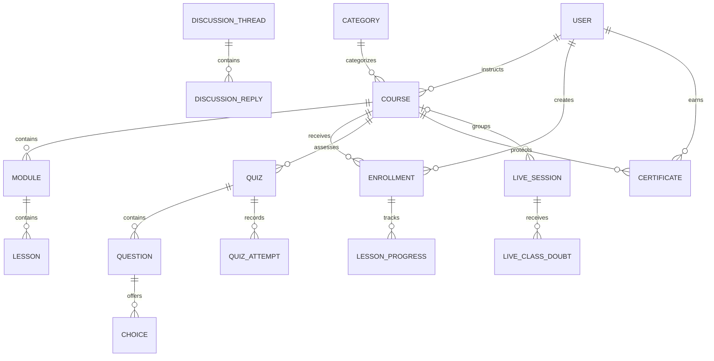

# Architecture and permissions

| Route | Anonymous | Learner or pending instructor | Approved instructor | Staff |
| --- | --- | --- | --- | --- |
| Public courses, community, live directory, certificate verification | Read | Read | Read | Read |
| Enrollment, lesson player, learner quiz | Sign in required | Own records; enrollment needed for lessons and quizzes | Same learner workflow | Same learner workflow |
| Course studio | Sign in required | Denied | Own courses | All courses |
| Schedule a live class | Sign in required | Denied | Own course or unassociated class | Allowed |
| Start, end, cancel or record a class | Sign in required | Denied | Own class | Allowed |
| Django admin and instructor approval | Denied | Denied | Requires staff authorization | Requires model permissions |

## Deployment checklist

- Verify database backup and duplicate-email remediation before applying migrations.
- Add or rotate the required secrets in the Render dashboard and keep them out of Git.
- Verify the health check, static manifest, and all public routes on the new commit.
- Verify account recovery, upload persistence after restart, and a two-participant video call.
- Check the public pages at mobile widths and record measured accessibility and performance before making claims.
